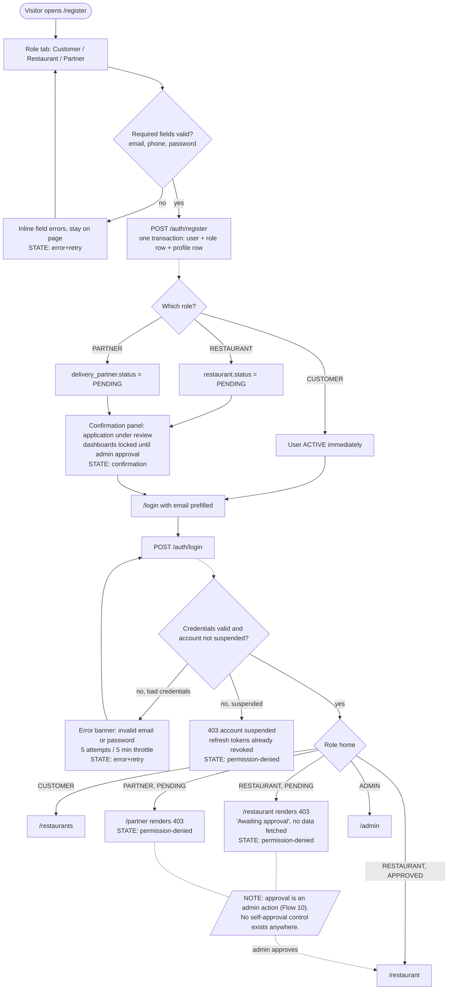
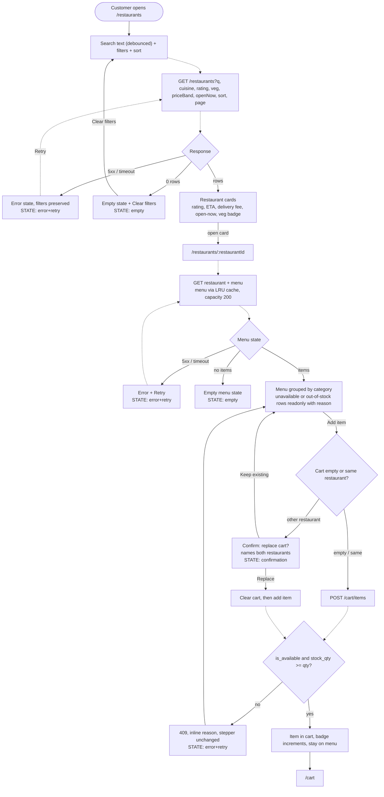
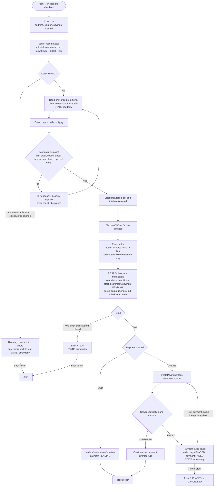
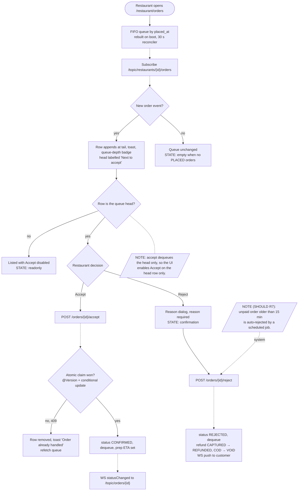
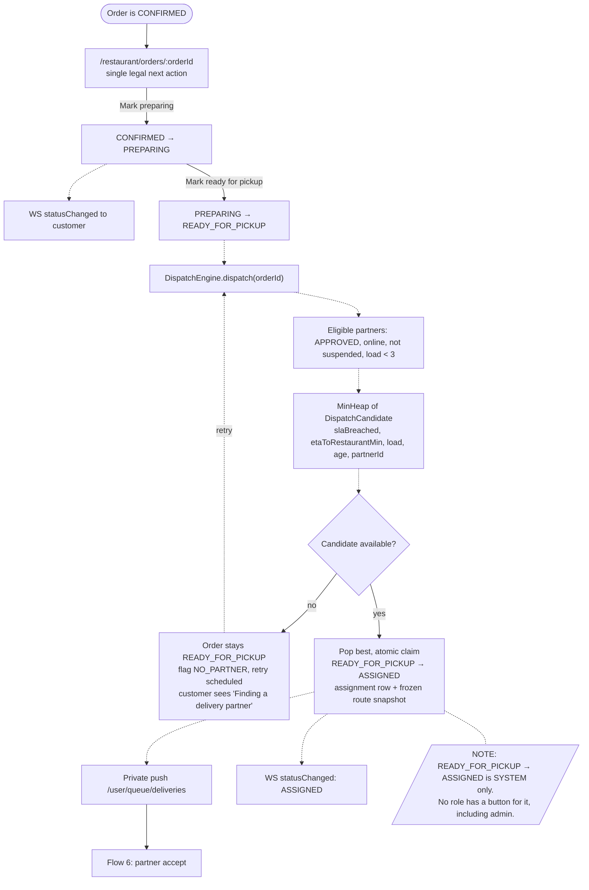
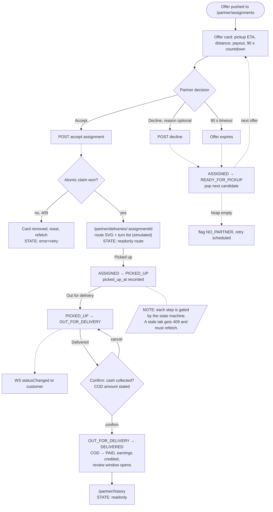
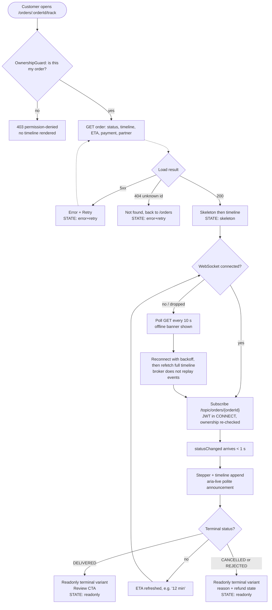
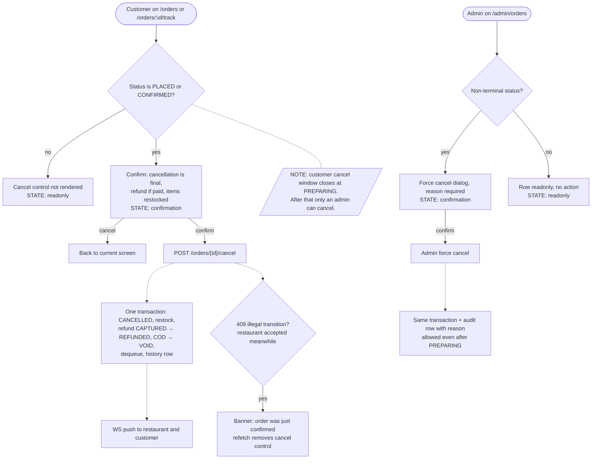
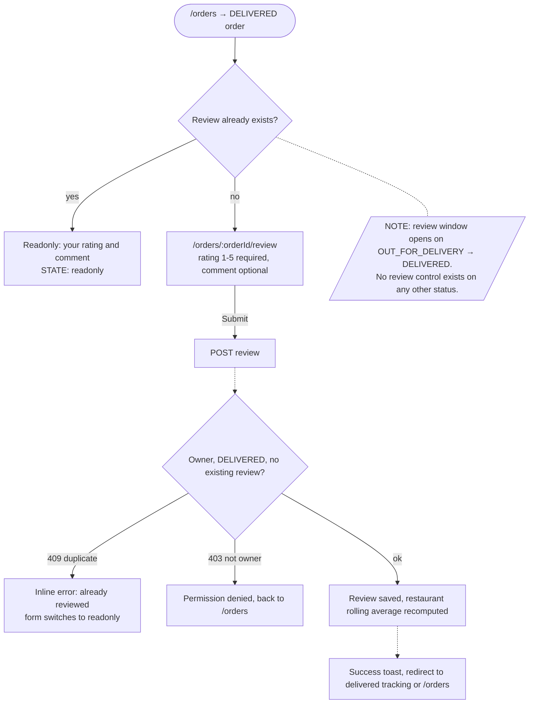
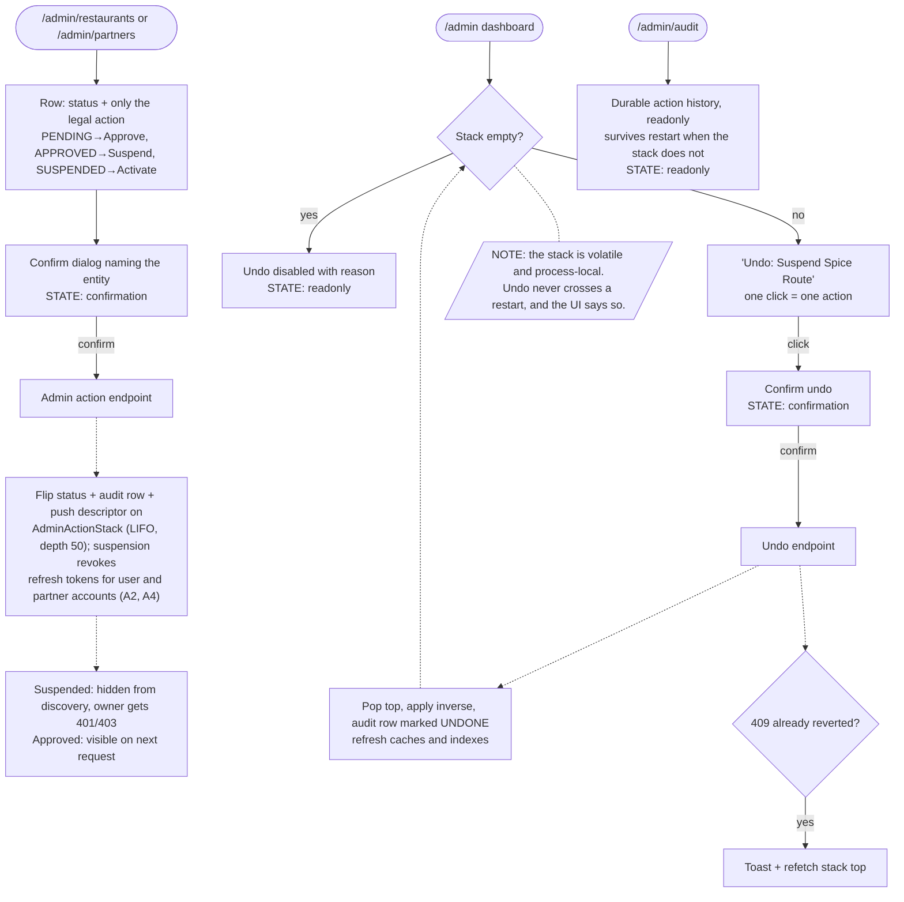

# User Flows — Smart Food Delivery Management System

Status: Phase 2 contract. Every screen in `design/flows/screen-inventory.md` must be reachable by
walking one of the flows below, and every flow below must end in a state the UI can render.
Source of truth: `docs/00-architecture-and-plan.md` (§2 features, §7 state machine) and
`docs/01-phases.md` (phase numbers, scope tiers).

This document describes **behaviour, not endpoints**. API paths shown in diagrams are the surface
implied by the architecture (`OrderController`, `CartController`, `AdminActionService`, ...); the
exact paths and DTOs are fixed in Phase 5. A path in this document is a label for a call, never a
commitment.

Out of scope by construction: nothing here adds a feature. Where a flow touches a `SHOULD` or
`STRETCH` item (search autocomplete, unpaid-order auto-reject, partner payout) the step is marked
with its tier and the flow still completes when that item is absent.

---

## 1. How to read these diagrams

| Element | Notation | Meaning |
|---|---|---|
| Start / terminal | `(["text"])` stadium | Entry point of the flow, or a terminal outcome |
| Screen / visible state | `["text"]` rectangle | A route from the canonical list, or a state rendered on it |
| Decision | `{"text"}` diamond | A branch. **Every** diamond has an explicit failure exit — no flow in this document shows only the happy path |
| Note | `[/"NOTE: text"/]` parallelogram | The rule, status code or business constraint that decides a branch. A note is annotation, never a screen |
| Data / external system | `[("text")]` cylinder | MySQL, the dispatch engine, the WebSocket broker |
| Solid arrow | `-->` | A **user action** (click, submit, navigate, type) |
| Dashed arrow | `-.->` | **System / async** work: HTTP call, transaction, WebSocket push, scheduled job, cache rebuild |
| Edge label | `-->|"text"|` | The condition, actor or payload for that edge |

Conventions used throughout:

* Status names are always written in `UPPER_SNAKE` exactly as the enum: `PLACED`, `CONFIRMED`,
  `PREPARING`, `READY_FOR_PICKUP`, `ASSIGNED`, `PICKED_UP`, `OUT_FOR_DELIVERY`, `DELIVERED`,
  `CANCELLED`, `REJECTED`.
* "STATE: ..." inside a node names the mandatory UI state from the screen inventory
  (`skeleton`, `empty`, `error+retry`, `permission-denied`, `confirmation`, `readonly`).
* A red/terminal outcome is drawn, not implied. If a flow can dead-end, the dead-end is a node.

### 1.1 Transition authority (from `docs/00-architecture-and-plan.md` §7.1)

This table is the single reference for "who may fire what". Every frontend rule in §13 is derived
from it.

| Transition | Actor | Side effects in the same transaction |
|---|---|---|
| `PLACED` → `CONFIRMED` | Restaurant (owner) | Dequeue from FIFO queue, set prep ETA |
| `PLACED` → `REJECTED` | Restaurant (owner) | Dequeue, refund if paid, notify customer |
| `PLACED` / `CONFIRMED` → `CANCELLED` | Customer (owner) or Admin | Restock items, refund if paid, dequeue |
| `CONFIRMED` → `PREPARING` | Restaurant (owner) | Notify customer |
| `PREPARING` → `READY_FOR_PICKUP` | Restaurant (owner) | Trigger dispatch engine |
| `READY_FOR_PICKUP` → `ASSIGNED` | **System only** (dispatch) | Create assignment + route snapshot |
| `ASSIGNED` → `PICKED_UP` | Partner (assignee) | Record `picked_up_at` |
| `PICKED_UP` → `OUT_FOR_DELIVERY` | Partner (assignee) | Notify customer |
| `OUT_FOR_DELIVERY` → `DELIVERED` | Partner (assignee) | Mark COD paid, credit earnings, open review window |
| `ASSIGNED` → `READY_FOR_PICKUP` | **System only** (decline or 90 s timeout) | Re-dispatch to next candidate |
| any non-terminal → `CANCELLED` after `PREPARING` | **Admin only** | Refund + audit reason |
| any illegal pair | — | `409 Conflict` (`InvalidTransitionException`), never a silent no-op |

`NO_PARTNER` is a **flag on the order, not a status**. It never appears in the status enum or the
status stepper; the order stays `READY_FOR_PICKUP` while dispatch retries.

---

## 2. Flow 1 — Registration and first login

Routes: `/register`, `/login`, `/restaurants`, `/restaurant`, `/partner`

1. Visitor opens `/register` and picks a role tab: Customer, Restaurant or Partner.
2. Client validates required fields (email, phone, password) before submitting; failures stay on
   the page as inline field errors.
3. `POST /auth/register` creates the user, the role join row, and — for Restaurant or Partner — the
   profile row with `PENDING` status, in one transaction.
4. Customer accounts are usable immediately; the visitor is sent to `/login` with the email
   prefilled.
5. Restaurant and Partner accounts are created but **not approved**. The confirmation panel says the
   application is under review and that dashboards stay locked until an admin approves.
6. `POST /auth/login` either fails (bad credentials, rate limited at 5 attempts per 5 minutes per
   IP + email, or account suspended) or succeeds and returns the role set.
7. The client routes to the role home. Customer → `/restaurants`, Admin → `/admin`,
   Restaurant → `/restaurant`, Partner → `/partner`.
8. A `PENDING` (or `SUSPENDED`) restaurant or partner reaches its dashboard route, the dashboard API
   answers `403`, and the screen renders the **permission-denied** state with the reason and a sign
   out action. No KPI panels, no zero-filled cards — a pending account must never look like an empty
   dashboard.
9. Admin approval is a system action (Flow 10): the profile flips to `APPROVED` and the next login
   (or next request) succeeds.

---

## 3. Flow 2 — Browse, search, open restaurant, add to cart

Routes: `/restaurants`, `/restaurants/:restaurantId`, `/cart`

1. Customer lands on `/restaurants`. Search text is debounced; filters are cuisine, rating, veg,
   price band and open-now; sort is by rating, ETA, price or delivery fee.
2. `GET /restaurants` returns a page. Zero rows → **empty** state with a "Clear filters" action.
   Failure → **error+retry**, keeping the chosen filters.
3. Opening a card loads `/restaurants/:restaurantId` (detail + menu, served through an LRU menu
   cache keyed by restaurant id).
4. Menu items that are unavailable or out of stock stay **visible** but their Add control is
   disabled and the row is readonly with a reason ("Sold out", "Unavailable today"). Hiding them
   would break the customer's expectation of the menu they saw yesterday.
5. Add to cart is allowed only if the cart is empty or already belongs to this restaurant.
6. Adding an item from a **different** restaurant returns `409` with the current cart in the body.
   The UI opens a confirmation dialog naming both restaurants: "Replace cart?" — Replace clears the
   cart and adds the new item; Keep existing returns to the menu unchanged.
7. The cart re-validates availability and stock on the server (Phase 9). A quantity that exceeds
   stock is rejected with `409` and the stepper does not move.
8. Cart badge updates; the customer can continue browsing or go to `/cart`.

---

## 4. Flow 3 — Checkout, coupon, payment, order placed

Routes: `/cart`, `/checkout`, `/orders/:orderId/confirmation`

1. From `/cart` the customer proceeds to `/checkout`: pick a saved address, optionally apply a
   coupon, choose COD or online (sandbox).
2. The server recomputes `subtotal → coupon discount (capped) → taxable = subtotal − discount →
   tax 5% → delivery fee = 20 + 8 × Dijkstra km → total`. The client renders that breakdown
   read-only; it never computes or edits a total. Delivery fee is only shown after the address is
   chosen, because it depends on the route distance.
3. If the cart no longer passes validation (item unavailable, stock dropped, restaurant closed,
   price changed), checkout is blocked with a line-level error and a link back to `/cart`.
4. Coupon apply goes to the server. Any rule failure (min order, expiry, global limit, per-user
   limit, cap, first-order-only) returns a specific reason, the discount stays at zero, and the
   order can still be placed without the coupon. A coupon is never shown as applied before the
   server confirms it.
5. "Place order" is disabled while the request is in flight and carries an `idempotencyKey`
   generated once per attempt. A double click, a retry, or a network replay returns the same order.
6. `POST /orders` runs one transaction: snapshot items and address, conditional stock decrement,
   `payments` row `PENDING`, `OrderQueueRegistry.enqueue`, `OrderIndex.put`, then publishes
   `orderPlaced` to the restaurant topic. Stock conflict or a closed restaurant returns `409`.
7. COD: the customer goes straight to `/orders/:orderId/confirmation` with payment `PENDING`
   (becomes `PAID` on `DELIVERED`).
8. Online sandbox: create intent → simulate confirm → **server verifies** → `CAPTURED`. Capture
   failure sets payment `FAILED` and the order **stays `PLACED`** inside its retry window. The
   failure panel offers "Retry payment" (same idempotency key, so no second charge) or "Cancel
   order" (legal because the order is `PLACED`, Flow 8).
9. Success lands on `/orders/:orderId/confirmation`: order number, restaurant, ETA, total, payment
   status, and a single primary action "Track order".

---

## 5. Flow 4 — Restaurant accept or reject (FIFO queue)

Routes: `/restaurant/orders`, `/restaurant/orders/:orderId`

1. The restaurant opens `/restaurant/orders`. The queue is FIFO by `placed_at`, rebuilt from MySQL
   on boot and re-synced by a 30 s reconciler — never sorted on the client.
2. The queue head is labelled "Next to accept". `POST /orders/{id}/accept` dequeues the **head**, so
   Accept is enabled only on the head row; older rows further down are readonly until promoted.
   This keeps the FIFO invariant visible instead of pretending the client can reorder work.
3. A new order arrives as a WebSocket event on `/topic/restaurants/{id}/orders`; the row appends at
   the tail with a toast and a queue-depth badge. Failure to connect falls back to polling.
4. Accept: the server attempts an atomic claim (`@Version` + conditional update). If another
   terminal or a second click already took the order, the response is `409`; the row disappears and
   the queue refetches.
5. On success the order becomes `CONFIRMED`, the prep ETA is set, and the customer timeline receives
   a push.
6. Reject: a reason is mandatory and entered in a confirmation dialog. `PLACED → REJECTED` dequeues
   the order, refunds a captured payment (`REFUNDED`), voids a COD payment, and notifies the
   customer.
7. `SHOULD` R7: an unpaid order that breaches the 15-minute SLA is auto-rejected by a scheduled job.
   That is a dashed system path into the same `REJECTED` outcome; no restaurant control exists for
   "auto reject now".

---

## 6. Flow 5 — Preparation → ready for pickup → dispatch

Routes: `/restaurant/orders/:orderId`, handoff to `/partner/assignments`

1. From the queue or the order detail, the restaurant advances `CONFIRMED → PREPARING`. The detail
   screen shows exactly one status action at a time: the single legal next transition.
2. `PREPARING → READY_FOR_PICKUP` triggers the dispatch engine in the same request. The restaurant
   has no further control over the order: from here the rider flow owns it.
3. Dispatch filters partners to `APPROVED`, online, not suspended, with fewer than 3 active
   deliveries, builds a `DispatchCandidate` for each (Dijkstra partner→restaurant ETA plus
   prep-remaining), and pushes them onto a `MinHeap` ordered by SLA-breach risk, pickup ETA, current
   load, order age, then partner id as the deterministic tie-break.
4. The best candidate is popped and the order is claimed atomically
   (`READY_FOR_PICKUP → ASSIGNED`) with a `delivery_assignments` row and a frozen route snapshot.
5. The partner receives a private push on `/user/queue/deliveries`; the customer sees `ASSIGNED`.
6. If no candidate exists, the order stays `READY_FOR_PICKUP`, is flagged `NO_PARTNER`, and a retry
   is scheduled. The customer sees "Finding a delivery partner" — a message, not a new status.
7. Restaurant screens must show `READY_FOR_PICKUP` as terminal-for-them ("Waiting for pickup") with
   no advance button. Only dispatch can move the order on.

---

## 7. Flow 6 — Delivery partner: accept, pickup, out for delivery, delivered

Routes: `/partner/assignments`, `/partner/deliveries/:assignmentId`, `/partner/history`

1. An offer arrives at `/partner/assignments` (private queue) as a card: restaurant, drop area,
   pickup ETA, route distance, payout, and a 90-second countdown.
2. Accept → atomic claim. Losing the race returns `409`: the card is removed and the list refetched.
3. Decline, or letting the 90 s window expire, reverts the order to `READY_FOR_PICKUP` and pops the
   next candidate. If the heap is then empty, the order is flagged `NO_PARTNER` and retried.
4. After accepting, the partner opens `/partner/deliveries/:assignmentId`: route SVG over the seeded
   36-node graph, turn list, distance, ETA, drop address and the COD amount if any. Every route
   label says "simulated route" — this is a seeded graph, not GPS.
5. The active delivery always exposes exactly one primary action: `ASSIGNED → PICKED_UP` ("Picked
   up"), then `PICKED_UP → OUT_FOR_DELIVERY` ("Out for delivery"), then
   `OUT_FOR_DELIVERY → DELIVERED` ("Delivered").
6. "Delivered" needs confirmation, and for COD the dialog states the cash amount to collect.
   On success the order becomes `DELIVERED`, COD flips to `PAID`, earnings are credited, and the
   customer's review window opens.
7. Completed deliveries move to `/partner/history` (readonly), where earnings per delivery are
   shown. The partner can never reopen or un-deliver an order.

---

## 8. Flow 7 — Live tracking (customer view)

Routes: `/orders/:orderId/track`

1. The customer opens tracking from confirmation, history, or the WebSocket notification.
2. The server checks ownership (`OwnershipGuard`). Someone else's order id returns `403`
   **permission-denied**, not an empty timeline — an empty state here would mask an IDOR attempt.
3. Initial load returns status, ordered timeline (linked-list projection of
   `order_status_history`), ETA, payment status, restaurant and partner summary.
4. If the WebSocket is connected, the client subscribes to `/topic/orders/{orderId}`; the JWT is
   authenticated in the `CONNECT` frame and the subscription interceptor re-checks ownership.
   A push arrives in under a second and the stepper plus timeline update.
5. If the socket is unavailable, dropped, or reconnecting, the screen polls the order endpoint
   every 10 s and shows the offline banner. On reconnect the client refetches the **full** timeline,
   because events are not replayed by the broker.
6. Terminal statuses (`DELIVERED`, `CANCELLED`, `REJECTED`) unsubscribe and switch the screen to the
   readonly terminal variant: delivered shows the review CTA, cancelled/rejected shows the reason
   and refund state.
7. `404` (bad id) is an error+retry state; `403` is permission-denied; there is no "order deleted"
   state because orders are never deleted.

---

## 9. Flow 8 — Cancellation (customer window, admin force-cancel, refund and restock)

Routes: `/orders`, `/orders/:orderId/track`, `/admin/orders`

1. The customer's cancel control exists **only** while the order is `PLACED` or `CONFIRMED`. It is
   not rendered disabled at other statuses — it is not rendered at all.
2. Confirm dialog states the consequence: cancellation is final, a paid order is refunded, items are
   returned to stock.
3. `POST /orders/{id}/cancel` runs one transaction: status `CANCELLED`, restock items, refund if
   `CAPTURED` (online `REFUNDED`, COD `VOID`), dequeue from the restaurant queue, history row, push.
4. If the restaurant accepted the order between page load and click, the transition is illegal:
   `409`. The UI shows "This order was just confirmed by the restaurant" and refetches, which removes
   the cancel control.
5. Admin force-cancel from `/admin/orders` works on any non-terminal status, including after
   `PREPARING`, and requires a typed reason. It is always audited, and it follows the same
   cancel/refund/restock transaction.
6. Neither partner nor restaurant can cancel an order. Rejection (`PLACED → REJECTED`) is a separate,
   restaurant-only action (Flow 4) with its own terminal status and refund path.

---

## 10. Flow 9 — Review submission after delivery

Routes: `/orders`, `/orders/:orderId/review`

1. The review entry point appears only on `DELIVERED` orders and only when no review exists yet
   (one review per order, `UNIQUE(order_id)`).
2. The form shows the restaurant summary, a 1–5 star control (required) and an optional comment.
3. Submit posts the review. The server re-checks: order owned by this customer, status `DELIVERED`,
   no existing review.
4. Duplicate or ineligible submissions return `409` and the form stays with the reason; a successful
   submit recomputes the restaurant's rolling average.
5. After success the customer is sent back to the delivered tracking view (or `/orders`) with a
   success toast; revisiting `/orders/:orderId/review` now renders the **readonly** view of their own
   review.

---

## 11. Flow 10 — Admin: suspend/activate a restaurant, and undo the last action

Routes: `/admin/restaurants`, `/admin/partners`, `/admin`, `/admin/audit`

1. Admin filters `/admin/restaurants` by status. Each row shows the current status and only the
   actions legal for it: `PENDING → Approve`, `APPROVED → Suspend`, `SUSPENDED → Activate`.
2. Suspend (or activate) asks for confirmation, then calls the admin action endpoint.
3. The server flips the status, writes an `audit_logs` row and pushes a descriptor onto
   `AdminActionStack` (depth 50, LIFO, volatile). Suspension also revokes refresh tokens for customer
   and partner accounts (A2, A4); a suspended restaurant's owner is blocked by the status check on the
   next request. A suspended restaurant disappears from discovery immediately.
4. `/admin` shows the stack top as "Undo: Suspend Spice Route". With an empty stack the control is
   disabled and says why — no dead button.
5. Undo pops one entry, applies the inverse, writes an audit row marked `UNDONE`, and refreshes the
   affected caches/indexes. One click undoes one action; there is no multi-level undo UI.
6. After a backend restart the stack is empty by design (it is in-memory) while `/admin/audit` still
   shows the durable history. The UI must never promise undo across a restart.
7. Non-admins never see these screens; a `403` renders permission-denied. An undo on an already
   reverted action returns `409` and the control refreshes to the real stack top.

---

## 12. Screen-to-flow table

| Flow | Routes touched |
|---|---|
| 1 Registration and first login | `/register`, `/login`, `/restaurants`, `/restaurant` (pending state), `/partner` (pending state) |
| 2 Browse, search, restaurant, cart | `/restaurants`, `/restaurants/:restaurantId`, `/cart` |
| 3 Checkout, coupon, payment | `/cart`, `/checkout`, `/orders/:orderId/confirmation`, `/orders/:orderId/track` (failure exit) |
| 4 Restaurant accept or reject | `/restaurant/orders`, `/restaurant/orders/:orderId` |
| 5 Preparation and dispatch | `/restaurant/orders/:orderId`, `/partner/assignments` (handoff) |
| 6 Partner pickup to delivered | `/partner/assignments`, `/partner/deliveries/:assignmentId`, `/partner/history` |
| 7 Live tracking | `/orders/:orderId/track`, `/orders` (entry point) |
| 8 Cancellation and refund | `/orders`, `/orders/:orderId/track`, `/admin/orders` |
| 9 Review after delivery | `/orders`, `/orders/:orderId/review`, `/orders/:orderId/track` (delivered variant) |
| 10 Admin suspend and undo | `/admin`, `/admin/restaurants`, `/admin/partners`, `/admin/audit` |

---

## 13. Rules for the frontend derived from these flows

Each rule is testable in review. If a screen violates one, the screen is wrong, not the rule.

| # | Rule | Derived from |
|---|---|---|
| FR-1 | A customer route never renders Accept, Reject, Prepare, Ready, Picked up, Out for delivery, Delivered, Suspend, Approve or Undo. The customer sees status text only. | Flows 4, 5, 6, 10 |
| FR-2 | No role has a control for `READY_FOR_PICKUP → ASSIGNED`. Dispatch is the only actor; even admin has no button. | Flow 5, §7.1 |
| FR-3 | The customer cancel control exists only for `PLACED` and `CONFIRMED`. Outside that window it is absent, not disabled. | Flow 8 |
| FR-4 | Every restaurant order action shows exactly one legal next transition; the order detail never shows two competing status buttons. | Flow 5 |
| FR-5 | Accept is enabled only on the FIFO queue head. Non-head `PLACED` rows are readonly with the reason "earlier order waiting". | Flow 4 |
| FR-6 | Reject requires a reason and a confirmation dialog; the dialog states that the customer is refunded. | Flow 4 |
| FR-7 | An active delivery has exactly one primary action, matching the single legal transition; stale tabs get `409` and refetch. | Flow 6 |
| FR-8 | Offer accept is atomic from the client's point of view: on `409` the card is removed, never retried automatically. | Flow 6 |
| FR-9 | No client-computed money. Subtotals, discounts, tax, delivery fee and total are rendered exactly as the server returns them. | Flow 3 |
| FR-10 | A coupon is displayed as applied only after a successful server validation; failures keep the discount at zero and name the failed rule. | Flow 3 |
| FR-11 | One `idempotencyKey` per place-order attempt, reused for every payment retry. Double click never creates a second order. | Flow 3 |
| FR-12 | Status is never updated optimistically. The UI waits for the server response (or a WS event), because `409` is a real outcome. | Flows 4, 7 |
| FR-13 | A `403`/ownership failure renders permission-denied, never an empty list or empty timeline. | Flows 7, 9 |
| FR-14 | WebSocket is inbound only. No command is ever sent over STOMP; on reconnect the client refetches authoritative state. | Flow 7 |
| FR-15 | Terminal statuses unsubscribe from the order topic and render the readonly variant. | Flows 7, 9 |
| FR-16 | The review control exists only for `DELIVERED` orders without a review; otherwise the review route is readonly. | Flow 9 |
| FR-17 | Undo is a single-step, single-click action, disabled with an explicit reason when the stack is empty, and never offered after a restart. | Flow 10 |
| FR-18 | Pending or suspended accounts get a permission-denied dashboard, never a zero-filled dashboard. | Flow 1 |
| FR-19 | Destructive actions (cancel, reject, force-cancel, delete item, suspend, undo) always pass through a confirmation dialog that names the consequence. | Flows 4, 8, 10 |
| FR-20 | `NO_PARTNER` is rendered as a message inside `READY_FOR_PICKUP`, never as a status step, badge colour or filter option. | Flow 5, §7.3 |
| FR-21 | Real-time badges (queue depth, live counter, new offer) never replace the list; they annotate it, and the list remains the source of truth after refetch. | Flows 4, 6, 7 |
| FR-22 | Admin force-cancel requires a typed reason and is available on every non-terminal status, including after `PREPARING`. | Flow 8 |
