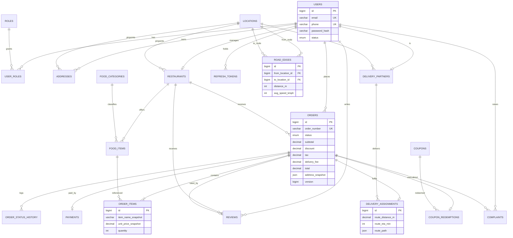

# Smart Food Delivery Management System — Architecture & Master Plan

> Status: **AWAITING APPROVAL**. No code has been written yet.
> Document version: 1.0 · Project type: College Major Project · Stack: React + Spring Boot + MySQL

---

## 0. Scope reality check (read this first)

The specification as written is roughly **180–240 files / 15,000–22,000 lines**. A student cannot
build all of it in one semester without cutting. So the plan is split into three tiers:

| Tier | Meaning | Target |
|---|---|---|
| **CORE** | Required for the demo + report. Non-negotiable. | ~90% of marks |
| **SHOULD** | Adds depth, cheap to build once CORE is stable. | Bonus marks |
| **STRETCH** | Impressive but droppable without breaking anything. | Show-off |

Everything in this document is tagged `[CORE]`, `[SHOULD]` or `[STRETCH]`. **Nothing is dropped
silently — if it is in your spec, it is in a tier.**

---

## 1. Final System Architecture

### 1.1 Style: Modular Monolith (NOT microservices)

For a college project, microservices = 4x the work, 4x the failure modes, zero extra marks for the
demo. We use a **layered modular monolith** with clean internal boundaries so it *reads* like a
professional system.

```
┌──────────────────────────────────────────────────────────────────────┐
│  BROWSER — React SPA (Vite + Tailwind + React Router)                │
│  Customer · Restaurant · Delivery · Admin dashboards                 │
└───────────────┬──────────────────────────────────┬───────────────────┘
                │ HTTPS  /api/v1/**                │ WSS  /ws (STOMP)
                │ Axios + JWT Bearer               │ JWT in CONNECT frame
┌───────────────▼──────────────────────────────────▼───────────────────┐
│  SPRING BOOT 3.5 APPLICATION                                          │
│                                                                       │
│  ┌──────────────── SECURITY LAYER ─────────────────┐                  │
│  │ JwtAuthFilter → SecurityFilterChain (RBAC)      │                  │
│  │ RateLimitFilter (custom token bucket)           │                  │
│  └──────────────────┬──────────────────────────────┘                  │
│  ┌──────────────────▼──────────────────────────────┐                  │
│  │ CONTROLLERS  (thin: parse → delegate → respond) │                  │
│  └──────────────────┬──────────────────────────────┘                  │
│  ┌──────────────────▼──────────────────────────────┐                  │
│  │ SERVICES  (@Transactional business logic)       │                  │
│  │  OrderService · PricingService · DispatchService│                  │
│  │  RouteService · PaymentService · ReportService  │                  │
│  └───────┬──────────────────────────────┬──────────┘                  │
│          │                              │                             │
│  ┌───────▼─────────────┐      ┌─────────▼──────────────────────────┐  │
│  │ REPOSITORIES (JPA)  │      │ DSA LAYER (pure Java, no JPA)      │  │
│  │ Spring Data         │      │ LinkedQueue · MinHeap · RoadGraph  │  │
│  │ interfaces          │      │ Dijkstra · MergeSort · QuickSort   │  │
│  └───────┬─────────────┘      │ LRU · Trie · ArrayStack · DLL      │  │
│          │                    └─────────┬──────────────────────────┘  │
│          │      ┌───────────────────────┘                             │
│          │      │  ADAPTERS (wire DSA ↔ DB, rebuild caches)          │
│          │      │  OrderQueueRegistry · DispatchEngine ·             │
│          │      │  GraphLoader · IndexRegistry                       │
│          ▼      ▼                                                    │
│  ┌──────────────────────────────────────────────┐                    │
│  │ EVENT PUBLISHER → WebSocket topics + audit    │                    │
│  └──────────────────┬───────────────────────────┘                    │
└─────────────────────┼────────────────────────────────────────────────┘
                      │ JDBC (HikariCP)
              ┌───────▼────────┐
              │  MySQL 8.0     │  source of truth, InnoDB, utf8mb4
              └────────────────┘
```

### 1.2 The five architectural rules we will enforce

1. **Controllers are dumb.** Max ~8 lines per method. No `if`, no repository calls. They validate
   the DTO (`@Valid`), call one service method, return `ResponseEntity`. Every rule a controller
   would need lives in the service.
2. **Service layer owns transactions.** `@Transactional` is on service methods only. Multi-step
   writes (place order, accept order, assign partner, refund) are single transactions with correct
   rollback behaviour.
3. **Entities never leave the backend.** Controllers return DTOs built by hand-written mappers.
   This prevents lazy-loading leaks, password exposure, and cyclic JSON.
4. **The `dsa` package imports nothing from Spring or JPA.** It is plain Java, unit-testable in
   milliseconds, and it is the part you show the examiner. Adapting DSA to the database happens in
   `service/support` adapters, never inside the data structures.
5. **The database is the source of truth; in-memory structures are rebuildable caches.** Every
   queue, heap and index can be reconstructed from MySQL on startup. We prove this in the viva by
   restarting the server mid-order.

### 1.3 Runtime topology

| Profile | Frontend | Backend | Notes |
|---|---|---|---|
| `dev` | Vite :5173 | Spring :8080 | Vite proxy `/api` + `/ws` → 8080 (no CORS pain) |
| `prod` | Nginx :80 serving `dist/` | Spring :8080 behind Nginx | Nginx reverse-proxies `/api`, `/ws` (Upgrade headers) |

### 1.4 Why WebSocket + REST together

REST for *commands* (place order, update status). WebSocket for *notifications* (a status changed —
here is the new state). We never accept a state change over WebSocket; it is broadcast-only. This
keeps authorization simple and auditable.

Topics:

```
/topic/orders/{orderId}          customer tracking timeline
/topic/restaurants/{id}/orders   new order ping + queue changes
/user/queue/deliveries           private push to a partner when assigned
/topic/admin/live                live order counter + alerts
```

STOMP handshake authenticates the JWT in the `CONNECT` frame; a user may only subscribe to their
own `/topic/orders/{id}` (subscription interceptor performs the ownership check).

---

## 2. Complete Feature Breakdown

### 2.1 Customer

| # | Feature | Tier | Business rule that makes it non-trivial |
|---|---|---|---|
| C1 | Register / login / logout / refresh | CORE | BCrypt, JWT access 15 min + refresh 7 d (rotating, hashed in DB) |
| C2 | Profile update, address CRUD, default address | CORE | Address is snapshotted into the order (historical accuracy) |
| C3 | Restaurant discovery (list, filter, sort, paginate) | CORE | Filter by cuisine/rating/veg/price band/open-now; sort via QuickSort on in-memory page |
| C4 | Search with autocomplete | SHOULD | Trie over restaurant + dish names |
| C5 | Restaurant detail + menu grouped by category | CORE | LRU menu cache; unavailable items shown but not orderable |
| C6 | Cart (single-restaurant cart) | CORE | Adding an item from another restaurant → confirm "replace cart" |
| C7 | Coupon validation | CORE | Min order, expiry, usage limit, per-user limit, max cap, first-order-only |
| C8 | Checkout → price breakdown | CORE | Server recomputes everything; client totals are never trusted |
| C9 | Payment (COD + online sandbox) | CORE | Idempotency key; duplicate capture blocked by unique index |
| C10 | Live order tracking | CORE | WebSocket timeline + ETA; custom linked list of status events |
| C11 | Order history + re-order | CORE | Re-order re-validates availability and current prices |
| C12 | Cancel order | CORE | Allowed only in `PLACED`/`CONFIRMED`; refund if paid; restocks items |
| C13 | Review a delivered order | CORE | One review per order (unique constraint); updates restaurant rolling average |
| C14 | Complaint / support ticket | SHOULD | Attached to an order, tracked by admin |

### 2.2 Restaurant Manager

| # | Feature | Tier | Notes |
|---|---|---|---|
| R1 | Register restaurant → PENDING | CORE | Needs admin approval before it is visible |
| R2 | Dashboard KPIs (today's orders, revenue, avg prep time) | CORE | Aggregated SQL + MergeSort report |
| R3 | Menu CRUD, categories, availability toggle, stock qty | CORE | Price change never mutates past orders (snapshots) |
| R4 | Incoming order queue (FIFO) | CORE | Custom linked queue; `peek()` = "next to accept" |
| R5 | Accept / reject with reason | CORE | Reject → auto refund + queue dequeue + WS push |
| R6 | Preparation status updates | CORE | `CONFIRMED → PREPARING → READY_FOR_PICKUP` only |
| R7 | Auto-reject unpaid orders / SLA breach alert | SHOULD | Scheduled job, 15 min timeout |
| R8 | Sales & popular-items report (date range) | CORE | MergeSort + HashMap frequency count |
| R9 | Payout view (gross − 12% commission) | SHOULD | Transparent commission rate column |

### 2.3 Delivery Partner

| # | Feature | Tier | Notes |
|---|---|---|---|
| D1 | Register → PENDING approval, set vehicle | CORE | Partner cannot log in to dashboard until approved |
| D2 | Go online / offline | CORE | Only online partners enter the assignment heap |
| D3 | Assignment offers (priority-queued) | CORE | Custom min-heap; score explained in §3.2 |
| D4 | Accept / decline assignment | CORE | Atomic claim; declined → re-dispatch to next candidate |
| D5 | Route view (SVG road network + turn list) | CORE | Dijkstra over custom adjacency-list graph |
| D6 | Pickup → out for delivery → delivered | CORE | Each step gated by status machine |
| D7 | Delivery history + earnings | CORE | Per-delivery payout ₹25 + ₹5/km |
| D8 | Live location ping | STRETCH | Simulated marker movement along the Dijkstra path |

### 2.4 Administrator

| # | Feature | Tier | Notes |
|---|---|---|---|
| A1 | Platform dashboard | CORE | GMV, orders/hour, active partners, SLA breaches |
| A2 | Customer management (list, suspend, activate) | CORE | Suspension revokes refresh tokens immediately |
| A3 | Restaurant approval / suspension | CORE | Reversible action → pushed onto the action stack |
| A4 | Partner approval / suspension | CORE | Same |
| A5 | Order monitoring + force-cancel with reason | CORE | Admin-only transition, always audited |
| A6 | Category management | CORE | |
| A7 | Coupon management | CORE | |
| A8 | Complaint resolution workflow | SHOULD | OPEN → IN_REVIEW → RESOLVED / REJECTED |
| A9 | Action history + **Undo last reversible action** | CORE | Custom stack (LIFO) + `audit_logs` durability |
| A10 | Analytics charts (7-day revenue, top restaurants) | CORE | Recharts |
| A11 | CSV export of orders | STRETCH | |

---

## 3. DSA → Feature Mapping (the heart of the project)

Every structure below is **hand-written** in `com.fooddelivery.dsa.*`. No `java.util.Queue`,
`PriorityQueue`, `HashMap`-as-the-answer, or `Collections.sort` where a custom structure is the
learning objective. `java.util` is used only for plumbing (e.g. `List` return types, `Comparator`
composition) and every such use is justified in a comment.

### 3.1 Master table

| # | Structure / Algorithm | File | Used by | Complexity | Tier |
|---|---|---|---|---|---|
| 1 | `LinkedQueue<T>` (singly linked, head/tail) | `dsa/queue/LinkedQueue.java` | Restaurant incoming-order queue | enqueue O(1), dequeue O(1), peek O(1) | CORE |
| 2 | `MinHeap<T>` (array binary heap) | `dsa/heap/MinHeap.java` | Dispatch priority queue | push/pop O(log n), peek O(1) | CORE |
| 3 | `DispatchCandidate` (Comparable) | `dsa/heap/DispatchCandidate.java` | Delivery scoring | compare O(1) | CORE |
| 4 | `OrderIndex` / `RestaurantIndex` (HashMap wrappers) | `dsa/map/*.java` | O(1) lookups, cache | avg O(1), worst O(n) | CORE |
| 5 | `RoadGraph` (adjacency list) | `dsa/graph/RoadGraph.java` | Delivery network | add edge O(1), space O(V+E) | CORE |
| 6 | `Dijkstra` (heap-based) | `dsa/graph/Dijkstra.java` | Shortest route + distance-based fee | O((V+E) log V) | CORE |
| 7 | `MergeSort` (stable, generic) | `dsa/sorting/MergeSort.java` | Sales report ordering | O(n log n) guaranteed | CORE |
| 8 | `QuickSort` (3-way, median-of-three) | `dsa/sorting/QuickSort.java` | Price/cuisine sorting in menu page | avg O(n log n), worst O(n²) | CORE |
| 9 | `Searcher` (linear + binary) | `dsa/searching/Searcher.java` | Radius scan, price-band range search | O(n) / O(log n) | CORE |
| 10 | `DoublyLinkedList<T>` | `dsa/list/DoublyLinkedList.java` | Order tracking timeline, LRU internals | add O(1), traverse O(n) | CORE |
| 11 | `ArrayStack<T>` + `AdminActionStack` | `dsa/stack/ArrayStack.java` | Admin action history + undo | push/pop/peek O(1) | CORE |
| 12 | `LruCache<K,V>` (HashMap + DLL) | `dsa/cache/LruCache.java` | Menu cache, restaurant cache | get/put O(1) | SHOULD |
| 13 | `Trie` | `dsa/trie/Trie.java` | Search autocomplete | insert/search O(L) | STRETCH |
| 14 | `TokenBucketRateLimiter` | `dsa/ratelimit/TokenBucket.java` | Login/OTP throttling | O(1) | SHOULD |

### 3.2 Delivery assignment — the exact, defensible policy

A naive heap on "random priority" loses marks. Ours is a **composite ordering with a documented
business justification**, implemented as a lexicographic `compareTo` so tie-breaking is
deterministic (important: a heap is not stable, so ties MUST be broken by data, never by chance).

Candidate = (order, partner). Lower is better.

| Rank | Key | Field | Business justification |
|---|---|---|---|
| 1 | SLA breach risk | `slaBreached` (boolean) | An order already past its promised window jumps every queue — customer trust before profit. |
| 2 | Pickup ETA | `etaToRestaurantMin` = Dijkstra(partner→restaurant) / avgSpeed(vehicle) + prepRemaining | The partner who reaches the food soonest minimises total delivery time. |
| 3 | Current load | `activeDeliveries` | Fairness/utilisation: an idle partner beats an overloaded one at equal ETA. |
| 4 | Order age | `-minutesSincePlaced` | FIFO fairness across orders (older order first). |
| 5 | Partner id | `partnerId` | **Deterministic** final tie-break. |

Formula (documented in code and report):

```
priority = (slaBreached ? 0 : 1) * 1e9
         + etaToRestaurantMin * 1000
         + activeDeliveries  * 10
         + minutesSincePlaced
final tie-break: partnerId ASC
```

Why a heap and not sorting: partners go online/offline continuously; we push/pop
`O(log n)` instead of re-sorting `O(n log n)` on every change.

Rejected alternatives (mention these in the viva — examiners love trade-off reasoning):
* Pure distance → ignores kitchen prep time, sends riders to wait.
* Pure FIFO partner rotation → ignores geography, doubles fuel cost.
* Machine-learned score → unexplainable in a viva and untrainable without data.

### 3.3 Where each structure genuinely earns its place

* **Queue** — `POST /orders/{id}/accept` dequeues the FIFO head. Rebuilt at startup from
  `SELECT id FROM orders WHERE status='PLACED' AND restaurant_id=? ORDER BY placed_at`.
  A `@Scheduled` reconciler re-syncs every 30 s so a crash cannot desynchronise the queue.
* **Priority queue** — invoked only at `READY_FOR_PICKUP` (dispatch moment) and when a partner
  declines. Never polled per request.
* **HashMap** — `OrderIndex` maps `orderId → immutable OrderSummary` for tracking/WS payloads.
  Written through on create/update, rebuilt on boot. Worst case O(n) explained via hash collisions;
  mention Java 8+ treeification (O(log n) bins > 8) as an aside.
* **Graph + Dijkstra** — the graph is **seeded**, not live GPS. 36 nodes, 58 edges representing a
  fictional city grid. Every UI label says *"simulated route"*. Delivery fee is derived from the
  Dijkstra distance, so the algorithm has real financial consequences: `₹20 base + ₹8/km`.
* **Merge sort** — restaurant revenue report over a *fetched* result set (≤ 5,000 rows). Stability
  matters: equal revenue must preserve alphabetical order.
* **Quick sort** — food-item price bands in the menu page, 3-way partition handles many duplicate
  prices well.
* **Binary search** — "items under ₹X" over a price-sorted array; O(log n) after one O(n log n) sort
  amortised across repeated queries.
* **Linked list** — tracking timeline is an append-only `DoublyLinkedList<StatusEvent>` per active
  order, rendered oldest→newest with O(1) append and O(1) "latest event" access. Persisted to
  `order_status_history`; the list is the in-memory projection, the table is the record.
* **Stack** — admin actions. `push` on every reversible admin action (suspend/activate restaurant or
  partner, toggle coupon). "Undo last action" pops, applies the inverse, writes an audit row, and
  disables itself when the stack is empty (no dead button). Depth 50, volatile by design; the audit
  table is the durable log.
* **LRU** — menu cache keyed `restaurantId`, capacity 200, invalidated on menu write. Proves you
  understand cache eviction, not just caching.

### 3.4 Complexity cheat-sheet for the report

| Operation | Structure | Time | Space |
|---|---|---|---|
| Place order | DB + queue + index | O(log n) index, O(1) enqueue | O(1) |
| Accept order | queue dequeue | O(1) | O(1) |
| Dispatch partner | heap drain over P partners | O(P log P) → O(P log P) | O(P) |
| Route lookup | Dijkstra | O((V+E) log V) | O(V) |
| Menu page sort | QuickSort | avg O(k log k) | O(log k) |
| Revenue report | MergeSort | O(n log n) | O(n) |
| Price range search | binary search | O(log n) | O(1) |
| Order lookup | HashMap | avg O(1), worst O(n) | O(n) |

---

## 4. Database Design (MySQL 8, InnoDB, utf8mb4)

Conventions: `BIGINT` surrogate PKs, `DECIMAL(10,2)` for money (never `DOUBLE`), `DATETIME(6)` UTC,
`created_at`/`updated_at` on every mutable table, snake_case columns, FK indexes auto-created.

### 4.1 ER diagram



### 4.2 Table inventory

| Table | Purpose | Key constraints |
|---|---|---|
| `users` | All accounts, one table + role join | `UNIQUE(email)`, `UNIQUE(phone)` |
| `roles` | CUSTOMER / RESTAURANT / PARTNER / ADMIN | `UNIQUE(name)` |
| `user_roles` | M:N user↔role | PK(user_id, role_id) |
| `refresh_tokens` | Rotating refresh tokens | `UNIQUE(token_hash)`, index(user_id) |
| `addresses` | Customer addresses | index(user_id), FK location_id |
| `locations` | Graph vertices (id, name, lat, lng) | `UNIQUE(name)` |
| `road_edges` | Graph edges, undirected | `UNIQUE(from_location_id,to_location_id)`, `CHECK(distance_m>0)` |
| `restaurants` | Restaurant profile | `UNIQUE(owner_user_id)`, index(status, location_id) |
| `food_categories` | Starters, Mains, Desserts… | `UNIQUE(name)` |
| `food_items` | Menu items | `UNIQUE(restaurant_id,name)`, index(restaurant_id,is_available) |
| `orders` | Order header + money snapshot | `UNIQUE(order_number)`, index(customer_id,placed_at), index(restaurant_id,status), index(status) |
| `order_items` | Line items w/ **name+price snapshot** | index(order_id) |
| `payments` | Provider-agnostic payment record | `UNIQUE(idempotency_key)`, `UNIQUE(provider_payment_id)`, index(order_id) |
| `delivery_partners` | Partner profile + availability | `UNIQUE(user_id)`, index(is_available,status) |
| `delivery_assignments` | One per order, route snapshot | `UNIQUE(order_id)`, index(partner_id,status) |
| `order_status_history` | Append-only transition log | index(order_id,created_at) |
| `reviews` | Post-delivery rating | `UNIQUE(order_id)`, index(restaurant_id), `CHECK(rating between 1 and 5)` |
| `coupons` | Discount definitions | `UNIQUE(code)`, check date range |
| `coupon_redemptions` | Enforces per-user limits | `UNIQUE(coupon_id,order_id)`, index(coupon_id,user_id) |
| `complaints` | Support tickets | index(status), index(raised_by_user_id) |
| `audit_logs` | Durable admin/system action log | index(created_at), index(entity_type,entity_id) |

### 4.3 Design decisions you must be able to defend

1. **Snapshot columns in `order_items`** (`item_name_snapshot`, `unit_price_snapshot`) and
   `orders.address_snapshot` (JSON). A menu price edit or address deletion must never rewrite
   history. `food_item_id` stays as a nullable FK purely for analytics joins.
2. **`orders.version` (`@Version`)** — optimistic locking. Two partners accepting the same order
   simultaneously must not both win.
3. **Money as `DECIMAL(10,2)` + `BigDecimal`** — never floating point. All arithmetic through
   `Money` helper with `RoundingMode.HALF_UP`, scale 2.
4. **Status stored as `VARCHAR` + `@Enumerated(EnumType.STRING)`** — readable in MySQL Workbench,
   immune to ordinal reordering.
5. **`delivery_assignments.route_path` JSON** — the Dijkstra node sequence is frozen at assignment
   time so the UI always renders the route that was actually planned, even if the graph is edited.
6. **No soft-delete everywhere.** Only `users`, `restaurants`, `food_items`, `coupons` get
   `status`/`is_active`; orders are never deleted (financial record).
7. **Flyway owns the schema**, `spring.jpa.hibernate.ddl-auto=validate`. Your DBMS marks come from
   hand-written DDL, not `create-drop`.

---

## 5. Backend Folder Structure

```
backend/
├── pom.xml
├── mvnw / mvnw.cmd
└── src
    ├── main
    │   ├── java/com/fooddelivery/
    │   │   ├── FoodDeliveryApplication.java
    │   │   ├── config/
    │   │   │   ├── SecurityConfig.java          # filter chain, CORS, role rules
    │   │   │   ├── WebSocketConfig.java         # STOMP broker, endpoints
    │   │   │   ├── JpaAuditingConfig.java       # @CreatedDate / @LastModifiedDate
    │   │   │   ├── OpenApiConfig.java           # Swagger UI (SHOULD)
    │   │   │   └── AppProperties.java           # @ConfigurationProperties (jwt, pricing, dispatch)
    │   │   ├── controller/
    │   │   │   ├── AuthController.java
    │   │   │   ├── CustomerController.java
    │   │   │   ├── AddressController.java
    │   │   │   ├── RestaurantPublicController.java
    │   │   │   ├── CartController.java
    │   │   │   ├── OrderController.java
    │   │   │   ├── PaymentController.java
    │   │   │   ├── ReviewController.java
    │   │   │   ├── RestaurantAdminController.java
    │   │   │   ├── MenuController.java
    │   │   │   ├── DeliveryController.java
    │   │   │   ├── AdminController.java
    │   │   │   ├── CouponController.java
    │   │   │   ├── ReportController.java
    │   │   │   └── RouteController.java
    │   │   ├── service/
    │   │   │   ├── auth/{AuthService,JwtService,RefreshTokenService,CurrentUserService}.java
    │   │   │   ├── user/{UserService,AddressService}.java
    │   │   │   ├── restaurant/{RestaurantService,MenuService,RestaurantQueryService}.java
    │   │   │   ├── cart/{CartService,CartValidator}.java
    │   │   │   ├── order/{OrderService,OrderStateMachine,OrderTimelineService,
    │   │   │   │          OrderQueueRegistry,OrderCancellationService}.java
    │   │   │   ├── pricing/{PricingService,CouponService,DeliveryFeeCalculator}.java
    │   │   │   ├── delivery/{DeliveryService,DispatchEngine,PartnerService}.java
    │   │   │   ├── route/{RouteService,GraphLoader}.java
    │   │   │   ├── payment/{PaymentService,PaymentProvider,SimulatedPaymentProvider}.java
    │   │   │   ├── review/{ReviewService}.java
    │   │   │   ├── admin/{AdminService,AdminActionService,ComplaintService}.java
    │   │   │   ├── report/{ReportService,AnalyticsService}.java
    │   │   │   └── support/{OrderIndex,RestaurantIndex,MenuItemIndex,PartnerIndex}.java
    │   │   ├── repository/            # 20 Spring Data interfaces
    │   │   ├── entity/
    │   │   │   ├── BaseEntity.java    # id, createdAt, updatedAt
    │   │   │   ├── User.java, Role.java, RefreshToken.java, Address.java
    │   │   │   ├── Restaurant.java, FoodCategory.java, FoodItem.java
    │   │   │   ├── Order.java, OrderItem.java, OrderStatusHistory.java
    │   │   │   ├── Payment.java, DeliveryPartner.java, DeliveryAssignment.java
    │   │   │   ├── Review.java, Coupon.java, CouponRedemption.java
    │   │   │   ├── Complaint.java, AuditLog.java
    │   │   │   └── Location.java, RoadEdge.java
    │   │   ├── dto/
    │   │   │   ├── auth/  user/  restaurant/  menu/  cart/  order/
    │   │   │   ├── payment/  delivery/  admin/  report/  common/
    │   │   │   └── common/{ApiResponse,PageResponse,ApiError}.java
    │   │   ├── mapper/               # hand-written, static methods
    │   │   ├── security/
    │   │   │   ├── JwtAuthenticationFilter.java
    │   │   │   ├── JwtService.java
    │   │   │   ├── CustomUserDetailsService.java
    │   │   │   ├── RateLimitFilter.java
    │   │   │   ├── SecurityUser.java
    │   │   │   └── OwnershipGuard.java   # "is this order mine?"
    │   │   ├── exception/
    │   │   │   ├── GlobalExceptionHandler.java
    │   │   │   ├── ApiException.java
    │   │   │   ├── ErrorCode.java
    │   │   │   └── *NotFoundException, *ConflictException, InvalidTransitionException
    │   │   ├── validation/           # custom validators (phone, coupon code, time range)
    │   │   ├── enums/                # OrderStatus, PaymentStatus, RoleName, ...
    │   │   ├── dsa/
    │   │   │   ├── queue/LinkedQueue.java
    │   │   │   ├── stack/ArrayStack.java
    │   │   │   ├── heap/{MinHeap,DispatchCandidate}.java
    │   │   │   ├── graph/{RoadGraph,Dijkstra,RouteResult,Edge}.java
    │   │   │   ├── sorting/{MergeSort,QuickSort,Sorters}.java
    │   │   │   ├── searching/Searcher.java
    │   │   │   ├── list/DoublyLinkedList.java
    │   │   │   ├── map/SimpleHashMap.java
    │   │   │   ├── cache/LruCache.java
    │   │   │   ├── trie/Trie.java
    │   │   │   └── ratelimit/TokenBucket.java
    │   │   ├── websocket/
    │   │   │   ├── OrderEventPublisher.java
    │   │   │   └── StompAuthChannelInterceptor.java
    │   │   └── util/{Money,OrderNumberGenerator,GeoUtil,DistanceUtil}.java
    │   ├── resources/
    │   │   ├── application.yml
    │   │   ├── application-dev.yml
    │   │   ├── application-prod.yml
    │   │   ├── db/migration/V1__schema.sql  V2__seed.sql
    │   │   └── data/{graph-nodes.csv, menu-images/}
    │   └── test/java/com/fooddelivery/
    │       ├── dsa/{queue,stack,heap,graph,sorting,searching,cache}/*Test.java
    │       ├── service/{OrderServiceTest,PricingServiceTest,DispatchEngineTest}.java
    │       ├── integration/{AuthFlowIT,OrderLifecycleIT}.java
    │       └── support/TestFixtures.java
```

**Package rule:** `dsa` ← no Spring/JPA imports. `entity` ← no DTO imports. `service` ← no
`HttpServletRequest`. Enforce with an ArchUnit test `[SHOULD]` — one test file that proves the
architecture, great for the report.

---

## 6. Frontend Folder Structure

```
frontend/
├── package.json  vite.config.js  tailwind.config.js  postcss.config.js
├── .env.example
└── src/
    ├── main.jsx  App.jsx  index.css
    ├── api/
    │   ├── axiosClient.js            # baseURL, interceptors, refresh queue
    │   ├── authApi.js  restaurantApi.js  cartApi.js  orderApi.js
    │   ├── deliveryApi.js  adminApi.js  paymentApi.js  reportApi.js
    │   └── wsClient.js               # STOMP client + reconnect
    ├── context/
    │   ├── AuthContext.jsx           # user, roles, login/logout, silent refresh
    │   ├── CartContext.jsx
    │   └── ToastContext.jsx
    ├── hooks/
    │   ├── useAuth.js  useCart.js  useOrderTracking.js
    │   ├── useDebounce.js  usePagination.js  useAsync.js
    ├── routes/
    │   ├── AppRoutes.jsx
    │   ├── ProtectedRoute.jsx        # role-based guard
    │   └── roleHome.js               # role → landing route
    ├── layouts/
    │   ├── PublicLayout.jsx  CustomerLayout.jsx
    │   ├── RestaurantLayout.jsx  DeliveryLayout.jsx  AdminLayout.jsx
    ├── components/
    │   ├── ui/                       # Button, Input, Select, Modal, Drawer, Badge,
    │   │                             # Card, Table, Tabs, Toast, Spinner, Skeleton,
    │   │                             # EmptyState, ErrorState, Pagination, ConfirmDialog
    │   ├── common/{Navbar,Footer,RequireRole,ThemeToggle,StatusBadge,Avatar}.jsx
    │   ├── restaurant/{RestaurantCard,FilterBar,RatingStars,OpenNowBadge}.jsx
    │   ├── menu/{MenuItemCard,CategoryTabs,QuantityStepper}.jsx
    │   ├── cart/{CartDrawer,CartItemRow,PriceBreakdown,CouponBox}.jsx
    │   ├── order/{OrderTimeline,StatusStepper,LiveEta,OrderCard,OrderQueueTable}.jsx
    │   ├── delivery/{RouteMap,RouteSteps,AssignmentCard,OnlineToggle}.jsx
    │   └── charts/{RevenueLineChart,TopItemsBarChart,StatCard}.jsx
    ├── pages/
    │   ├── public/{Landing,Login,Register,NotFound}.jsx
    │   ├── customer/{Restaurants,RestaurantDetail,Cart,Checkout,
    │   │             OrderTracking,OrderHistory,Profile,ReviewForm}.jsx
    │   ├── restaurant/{Dashboard,MenuManagement,IncomingOrders,
    │   │               OrderDetail,SalesReport,RestaurantProfile}.jsx
    │   ├── delivery/{Dashboard,ActiveDelivery,RouteView,History,PartnerProfile}.jsx
    │   └── admin/{Dashboard,Users,Restaurants,Partners,Orders,
    │               Coupons,Categories,Complaints,Analytics,AuditLog}.jsx
    ├── utils/{formatCurrency,formatDate,statusMeta,validators,constants}.js
    └── assets/
```

**UI/UX system (locked before any page is built):**

* Tokens: brand `#E23744` (appetite red), ink `#1C1C1C`, surface `#FFFFFF`, muted `#6B7280`,
  success/warning/danger semantic colours, 4-px spacing scale, radius 8/12/16.
* Typography: Inter (400/500/600/700), 12/14/16/20/24/32 scale.
* Status colour language, one source of truth in `statusMeta.js`:
  `PLACED` grey → `CONFIRMED` blue → `PREPARING` amber → `READY_FOR_PICKUP` violet →
  `ASSIGNED` indigo → `PICKED_UP` cyan → `OUT_FOR_DELIVERY` teal → `DELIVERED` green;
  `CANCELLED`/`REJECTED` red.
* Every list has 4 states: loading skeleton, empty state with a CTA, error with retry, data.
* Mobile-first (360 px) → tablet (768) → desktop (1280). Restaurant/delivery dashboards are
  usable on a phone because that is how they are used in reality.
* Accessibility: focus rings, `aria-label` on icon buttons, 4.5:1 contrast, keyboard-navigable modals.
* **No dead buttons.** Anything not implemented is not rendered (feature flag), never a `TODO` alert.

---

## 7. Main Workflows

### 7.1 Order lifecycle — one explicit state machine

```
                    ┌────────────► CANCELLED (terminal)
                    │                   ▲
   PLACED ──accept──► CONFIRMED ──► PREPARING ──► READY_FOR_PICKUP
     │  ▲                 │                            │
     │  └──reject──► REJECTED (terminal)               │ dispatch
     └────customer cancel (PLACED | CONFIRMED)         ▼
                                                    ASSIGNED ──► PICKED_UP ──► OUT_FOR_DELIVERY ──► DELIVERED (terminal)
                                                        │
                                                        └── partner declines ──► READY_FOR_PICKUP (re-dispatch)
```

Implemented as `Map<OrderStatus, Set<OrderStatus>> ALLOWED` in `OrderStateMachine` + a per-transition
**actor rule** (who may fire it):

| Transition | Actor | Side effects (same transaction) |
|---|---|---|
| PLACED→CONFIRMED | RESTAURANT (owner) | dequeue from FIFO queue, set prep ETA |
| PLACED→REJECTED | RESTAURANT (owner) | dequeue, refund if paid, notify customer |
| PLACED/CONFIRMED→CANCELLED | CUSTOMER (owner) / ADMIN | restock items, refund, dequeue |
| CONFIRMED→PREPARING | RESTAURANT | notify customer |
| PREPARING→READY_FOR_PICKUP | RESTAURANT | trigger dispatch engine |
| READY_FOR_PICKUP→ASSIGNED | SYSTEM (dispatch) | create assignment + route snapshot |
| ASSIGNED→PICKED_UP | PARTNER (assignee) | record picked_up_at |
| PICKED_UP→OUT_FOR_DELIVERY | PARTNER | notify customer |
| OUT_FOR_DELIVERY→DELIVERED | PARTNER | mark COD paid, credit earnings, open review window |
| any→CANCELLED after PREPARING | ADMIN only | refund + audit reason |

Illegal transition → `409 Conflict` with `InvalidTransitionException` (never a silent no-op).
Every transition writes one `order_status_history` row **and** pushes a WebSocket event.

### 7.2 Place order (the most complex transaction)

1. `POST /api/v1/orders` with `{addressId, couponCode?, paymentMethod, items[{foodItemId, qty}], idempotencyKey}`.
2. Server ignores any client-sent price. Loads items, checks `is_available`, `stock_qty ≥ qty`,
   all items belong to one restaurant, restaurant `APPROVED` and open.
3. `PricingService`: `subtotal → coupon discount (capped) → taxable = subtotal − discount →
   tax 5% → deliveryFee = 20 + 8 × dijkstraKm → total`, all `BigDecimal.HALF_UP`.
4. Persist `orders` + `order_items` (snapshots) + `payments(PENDING)` in one transaction.
5. Decrement stock with a conditional update (`WHERE stock_qty >= :qty`) — no oversell under
   concurrency. On 0 rows → `409`.
6. `OrderQueueRegistry.enqueue(restaurantId, orderId)` + `OrderIndex.put(...)`.
7. Publish `orderPlaced` to restaurant topic; return `201` + order DTO.
8. Idempotency: repeated `idempotencyKey` returns the original order, never a duplicate.

### 7.3 Dispatch (priority queue in action)

`READY_FOR_PICKUP` → `DispatchEngine.dispatch(orderId)`:
filter partners (`APPROVED`, `is_available`, not suspended, load < 3) → for each, compute
`DispatchCandidate` (Dijkstra distance → ETA) → `MinHeap.push` → pop best → atomic claim
(`UPDATE ... WHERE status='READY_FOR_PICKUP'`) → create `delivery_assignments` with route snapshot
→ notify partner via `/user/queue/deliveries`. If the partner declines within 90 s or the claim
loses the race → pop the next candidate. Empty heap → schedule retry, flag order as `NO_PARTNER`.

### 7.4 Payment

| Method | Flow |
|---|---|
| COD | `payments` row `PENDING` → on DELIVERED `PAID`. Cancellation → `VOID`. |
| Online (sandbox) | `createPaymentIntent` → provider order id → client confirms → **server verifies signature** `→ CAPTURED`. Failure → `FAILED` + order stays `PLACED` with a retry window. |

`PaymentProvider` interface + `SimulatedPaymentProvider` (`[CORE]`) or `RazorpayProvider` (`[SHOULD]`,
test keys). Duplicate charge prevented by `UNIQUE(idempotency_key)` + `UNIQUE(provider_payment_id)`.
Card data never touches our server or DB.

### 7.5 Security model

* `SecurityFilterChain` rules by path prefix → role (`/api/v1/admin/**` = ADMIN, etc.), plus
  method-level `@PreAuthorize` where a path is shared.
* **Ownership is checked in the service, not the path.** `OwnershipGuard.assertOrderOwner(orderId, principal)`
  before any read/write of a customer's or partner's own resource (prevents IDOR — a classic
  vulnerability examiners ask about).
* BCrypt strength 10; passwords never logged or returned; `@JsonIgnore` on the hash.
* JWT: HS256, secret from env (`JWT_SECRET`), 15-min access, rotating refresh token stored as
  SHA-256 hash with revocation on logout/suspend.
* Rate limit: 5 login attempts / 5 min / IP + email using a custom token bucket.
* Errors: `GlobalExceptionHandler` returns `{timestamp, status, code, message, fieldErrors[]}` —
  never a stack trace, never an entity.
* CORS: explicit origin allow-list from config.

---

## 8. Realistic Development Roadmap

Assumes ~12–15 focused hours/week. Each phase ends with **something demonstrable** — never a
half-built layer.

| Week | Phase | Deliverable | Gate |
|---|---|---|---|
| 1 | P1 Requirements + architecture + ER | this document, Figma wireframes, DDL draft | you approve |
| 2 | P2 Project skeleton | Maven + Vite running, Flyway schema created, health endpoint | `mvn test` green |
| 3 | P3 Auth & security | register/login/refresh, RBAC, 4 seeded roles | Postman auth collection |
| 4 | P4 Restaurant + menu + categories | admin approval, menu CRUD, public catalog | screenshots |
| 5 | P5 DSA core (pure, test-first) | queue, stack, heap, sorts, searches, DLL, LRU + 40 unit tests | all DSA tests green |
| 6 | P6 Cart + pricing + coupons | server-side totals, coupon rules | price tests |
| 7 | P7 Order lifecycle + queue + WS | place/accept/reject/prepare, live tracking | two browsers sync live |
| 8 | P8 Graph + Dijkstra + fees | seeded road network, route API, distance-based fee | route screenshot |
| 9 | P9 Dispatch + partner module | priority assignment, pickup/deliver flow | end-to-end delivery |
| 10 | P10 Payments + cancellation + refunds | COD + sandbox, idempotency, restock | failure-path demo |
| 11 | P11 Admin + analytics + audit stack | dashboards, undo, complaints, reports | report charts |
| 12 | P12 Hardening | tests ≥ 70% on services, validation, error pages, perf pass | CI green |
| 13 | P13 Docs + report + viva | report, diagrams, screenshots, demo script, 30 Q&A | submission |

**Cut-list if you fall behind (in this order):** CSV export → live location ping → Trie
autocomplete → Razorpay real integration → complaints → partner earnings page.
**Never cut:** order state machine, custom DSA implementations, Dijkstra, JWT/RBAC, DSA unit tests.

### Definition of Done (applies to every feature)

`[ ]` Works via UI, not just Postman · `[ ]` Authorized (wrong role gets 403) · `[ ]` Ownership
checked · `[ ]` Validated DTO · `[ ]` Transactional · `[ ]` Audited/logged · `[ ]` Unit test ·
`[ ]` Loading/empty/error UI states · `[ ]` Documented in README.

---

## 9. Verification: how we prove it is real

1. **Restart test** — kill the backend mid-order, restart, show the queue and indexes rebuild from
   MySQL and processing continues in the same order.
2. **Concurrency test** — two terminals accept the same order simultaneously; exactly one wins
   (`@Version` + conditional update).
3. **Oversell test** — 5 parallel checkouts for 3 remaining units; exactly 3 succeed.
4. **IDOR test** — customer A requests customer B's order id → 403, logged.
5. **Illegal transition test** — `DELIVERED → PREPARING` → 409.
6. **DSA benchmarks** — JUnit timing table in the report comparing custom sort vs `Arrays.sort`,
   and lookup with 10k entries in HashMap vs linear scan.

---

## 10. Decisions I need from you before Phase 2

1. **Versions** — Java 21 + Spring Boot 3.5.x + MySQL 8 + Flyway (recommended) vs Java 17 + Boot 3.3.
2. **Auth tokens** — access token in memory + HttpOnly refresh cookie (recommended, secure) vs
   both tokens in `localStorage` (simpler, weaker — easier to demo).
3. **Payments** — `SimulatedPaymentProvider` behind an interface (recommended, zero setup) vs real
   Razorpay test mode (needs an account + webhook tunnel).
4. **Route visualisation** — custom SVG of the seeded graph (recommended: no API key, offline demo,
   shows the algorithm) vs Leaflet + OpenStreetMap tiles (prettier, needs internet at demo time).
5. **DB schema ownership** — Flyway SQL (recommended, showcases DBMS) vs Hibernate `ddl-auto=update`
   (faster to start).
6. **Scope tier** — confirm CORE only, CORE+SHOULD (recommended), or everything.
7. **Approval to start Phase 2** (skeleton + DDL + first runnable app).

Reply with `approve` plus any changes, and I will begin with Phase 2: Maven project, Flyway
schema, `application.yml`, and a hello-world endpoint you can hit in Postman — one step at a time,
with explanation and tests at each step.
