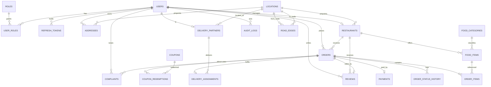

# Smart Food Delivery Management System - ER Diagram and Table Inventory

Database: MySQL 8.0, InnoDB, utf8mb4 / utf8mb4_0900_ai_ci.
Schema owner: Flyway (`backend/src/main/resources/db/migration/V1__schema.sql`).
Hibernate is configured with `ddl-auto=validate`, so the JPA entities must match this
schema byte-for-byte.

## 1. ER diagram (Mermaid)

## 2. Table inventory (22 tables)

| # | Table | Purpose | Key constraints |
|---|---|---|---|
| 1 | `roles` | CUSTOMER / RESTAURANT / DELIVERY_PARTNER / ADMIN | `UNIQUE(name)` |
| 2 | `users` | All accounts | `UNIQUE(email)`, `UNIQUE(phone)` |
| 3 | `user_roles` | M:N user to role | PK(user_id, role_id) |
| 4 | `refresh_tokens` | Rotating refresh tokens (hashed, revocable) | `UNIQUE(token_hash)`, idx(user_id) |
| 5 | `locations` | Graph vertices (36 seeded) | `UNIQUE(name)` |
| 6 | `road_edges` | Graph edges, both directions (128 seeded) | `UNIQUE(from,to)`, `CHECK(distance_m > 0)` |
| 7 | `addresses` | Customer addresses | idx(user_id); FK location_id SET NULL |
| 8 | `restaurants` | Restaurant profile | `UNIQUE(owner_user_id)`, idx(status, location_id) |
| 9 | `food_categories` | Global taxonomy (8 seeded) | `UNIQUE(name)` |
| 10 | `food_items` | Menu items | `UNIQUE(restaurant_id, name)`, idx(restaurant_id, is_available) |
| 11 | `cart_items` | Server-side cart | `UNIQUE(user_id, food_item_id)` |
| 12 | `orders` | Order header + money | `UNIQUE(order_number)`, idx(customer_id, placed_at), idx(restaurant_id, status), `@Version` |
| 13 | `order_items` | Line items with name + price snapshot | idx(order_id) |
| 14 | `payments` | Provider-agnostic payment | `UNIQUE(idempotency_key)`, `UNIQUE(provider_payment_id)` |
| 15 | `delivery_partners` | Partner profile + availability | `UNIQUE(user_id)`, idx(is_available, status) |
| 16 | `delivery_assignments` | One per order, route snapshot JSON | `UNIQUE(order_id)`, idx(partner_id, status) |
| 17 | `order_status_history` | Append-only transition log | idx(order_id, created_at) |
| 18 | `reviews` | Post-delivery rating | `UNIQUE(order_id)`, `CHECK(rating 1..5)` |
| 19 | `coupons` | Discount definitions | `UNIQUE(code)`, `CHECK(valid_to > valid_from)` |
| 20 | `coupon_redemptions` | Enforces per-user limits | `UNIQUE(coupon_id, order_id)` |
| 21 | `complaints` | Support tickets | idx(status), idx(raised_by_user_id) |
| 22 | `audit_logs` | Durable admin / system action log | idx(created_at), idx(entity_type, entity_id) |

## 3. Design decisions (defensible in the viva)

1. **Snapshot columns.** `order_items.item_name_snapshot` and `unit_price_snapshot`, plus
   `orders.address_snapshot` (JSON), preserve history. A menu price edit or address deletion
   never rewrites a past order. `food_item_id` stays as a nullable FK purely for analytics joins.
2. **Optimistic locking.** `orders.version` (`@Version`) prevents two partners from accepting
   the same order and two customers from overselling the last unit.
3. **Money as `DECIMAL(10,2)` + `BigDecimal`.** Never `DOUBLE`. All arithmetic goes through a
   `Money` helper with `RoundingMode.HALF_UP`, scale 2.
4. **Status as `VARCHAR` + `EnumType.STRING`.** Readable in MySQL Workbench and immune to
   ordinal reordering.
5. **`delivery_assignments.route_path` is JSON** and is frozen at assignment time, so the UI
   always renders the route that was actually planned even if the graph is later edited.
6. **No blanket soft delete.** Only `users`, `restaurants`, `food_items` and `coupons` carry a
   status / `is_active` flag. Orders are never deleted - they are financial records.
7. **Flyway owns the schema.** `spring.jpa.hibernate.ddl-auto=validate`. The DDL is hand-written,
   which is the DBMS component of the project.
8. **Least privilege.** The application connects as `foodapp`, not `root`. `foodapp` has only
   SELECT/INSERT/UPDATE/DELETE/CREATE/ALTER/INDEX/REFERENCES/DROP on `food_delivery.*`.

## 4. Relationships in words

- A `user` may hold several `roles` (M:N via `user_roles`), but in practice each account has
  exactly one operational role plus optionally ADMIN.
- A `user` owns many `addresses` and places many `orders`.
- A `user` may manage at most one `restaurant` (`UNIQUE owner_user_id`) and may be at most one
  `delivery_partner` (`UNIQUE user_id`).
- A `restaurant` offers many `food_items`, each classified by a global `food_category`.
- An `order` belongs to one customer and one restaurant, contains many `order_items`, has at most
  one `payment`, at most one `delivery_assignment`, and an append-only `order_status_history`.
- `order_items.food_item_id` is nullable so a deleted menu item does not break historical orders.
- A `delivery_assignment` references one order and one partner; its route snapshot is frozen.
- A `review` is unique per order and updates the restaurant's rolling average.
- A `coupon` has many `coupon_redemptions`, which enforce the per-user limit via a unique key.
- `complaints` attach to an order and track OPEN -> IN_REVIEW -> RESOLVED / REJECTED.
- `audit_logs` is append-only and stores the reversible flag used by the undo stack.

## 5. Indexes

Indexes exist on every foreign key and on the columns used by the list screens:
`(customer_id, placed_at)`, `(restaurant_id, status)`, `(status)`, `(partner_id, status)`,
`(restaurant_id, is_available)`, `(restaurant_id, created_at)` on reviews, and
`(entity_type, entity_id)` on audit logs. The slow-query log and `EXPLAIN` are reviewed in
Phase 17.

## 6. Seed data (V2__seed.sql)

- 4 roles, 8 food categories, 36 locations, 128 directed road edges.
- 4 users (admin, customer "Ayush Ekka", restaurant owner, partner "Rakesh Nayak").
- 1 approved restaurant "Spice Route" with 11 menu items.
- 1 address for the customer (mapped to graph node 14).
- 1 approved delivery partner (bike, node 14).
- 2 coupons (FIRST50, FLAT100).
- Passwords: Admin@123, Customer@123, Restaurant@123, Partner@123.
